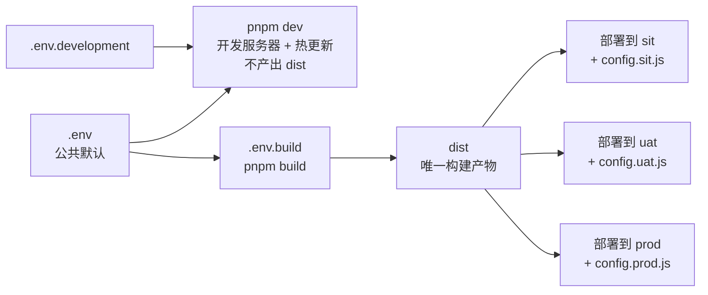

# vite-pkg-demo

一个**最小化的 Vue 3 + Vite 示例**，用来演示：

> **只构建一次，得到一份与环境无关的 `dist`；部署到 local / sit / uat / prod 时，只替换 `dist/config.js`。**

配套后端仓库：`../vite-pkg-demo-api`（四个端口分别模拟四个环境）。

## 1. 目录结构

```text
vite-pkg-demo/
├─ index.html                 # 入口：先加载 /config.js，再加载 module
├─ vite.config.ts             # define：把 VITE_* 替换为 window.__APP_CONFIG__ 读取
├─ .env                       # 构建期公共默认值
├─ .env.development           # 本地开发默认值（pnpm dev）
├─ .env.build                 # 构建模式默认值（所有部署环境共用，输出 dist）
├─ public/
│  └─ config.js               # 构建时复制到 dist/config.js（空模板）
├─ deploy/
│  ├─ config.local.js         # 四个环境的运行期配置
│  ├─ config.sit.js
│  ├─ config.uat.js
│  └─ config.prod.js
├─ src/
│  ├─ main.ts                 # 运行期标题 + 挂载
│  ├─ App.vue                 # 页面：展示配置与后端返回
│  ├─ config/runtime.ts       # 模拟 Yudao 的 axios config 读取
│  └─ api/info.ts             # 调用后端 /api/info
├─ tests/e2e.mjs              # 自动 E2E：四个环境一次跑完
└─ docs/REPLAY-GUIDE.md       # 如何把改动重放到完整 Yudao 项目
```

### 1.1 为什么只需要 3 个 `.env` 文件

不管最终有多少个**部署环境**（local / sit / uat / prod / 以后再加），Vite 侧只需要这 3 个文件：

| 文件 | 何时加载 | 作用 |
|---|---|---|
| `.env` | 所有 mode | 公共默认值，例如 `VITE_API_URL=/api` |
| `.env.development` | `pnpm dev`（mode=`development`） | 本地开发：端口、代理、本地标题等 |
| `.env.build` | `pnpm build`（mode=`build`） | **构建模式**：输出目录、压缩、构建期兜底值 |



#### 关键澄清

1. **`.env.build` 是"构建模式"，不是任何部署环境。**
   sit / uat / prod 三个部署环境**共用同一份** `pnpm build` 产物。
2. **部署环境数量不决定 `.env` 数量。**
   新增一个部署环境时，只需要新增 `deploy/config.<new-env>.js`，不需要新增 `.env`。
3. **`development` vs `build` 对应的是"开发/构建"，不是"测试/生产"。**
   - `pnpm dev`：不打包，热更新，用于日常开发；
   - `pnpm build`：打包一次，产出 `dist`，用于所有部署环境。
4. **各部署环境的差异不写进 `.env`。**
   后端地址、标题、租户/验证码开关等全部写在 `deploy/config.<env>.js`，运行时覆盖。
5. **`deploy/config.local.js` 不参与 `pnpm dev`。**
   它是"构建产物 + 本地后端"的运行期配置；`pnpm dev` 使用的是 `.env.development`。
6. **Vite 还会自动加载 `.env.local`**（如果存在），它优先级较高且**所有 mode 都会加载**。
   它是本地私有文件，不入库；CI 构建机必须确保不存在，否则可能把本机配置带进产物。

#### 想改配置时应该改哪里

| 想改什么 | 改哪里 |
|---|---|
| 本地开发端口、Vite 代理、本地标题 | `.env.development` |
| 构建输出目录、压缩、sourcemap、构建期兜底值 | `.env.build` |
| 某个部署环境的 API 地址、标题、功能开关 | `deploy/config.<env>.js` |
| 所有环境共享的默认值 | `.env` |

> 本示例刻意使用 `.env.build` 而不是 `.env.prod`，避免把"构建模式"误读为"prod 部署环境"。
> 如果目标 Yudao 项目继续使用 `--mode prod`，只需把它理解为"构建模式"即可；
> 也可以同样改名为 `.env.build` 并把脚本改为 `--mode build`。

## 2. 环境要求

- Node.js `>= 20.19.0`
- pnpm `>= 8.6.0`（推荐 `corepack pnpm ...`）
- 本机 Chrome（E2E 默认使用 `/usr/bin/google-chrome`，可用 `CHROME_PATH` 覆盖）

## 3. 启动演示

### 3.1 启动后端（四个端口）

```bash
cd ../vite-pkg-demo-api
node start-all.mjs
```

输出 `READY {...}` 表示 local/sit/uat/prod 四个后端已就绪。

### 3.2 启动前端开发服务器

```bash
cd ../vite-pkg-demo
corepack pnpm install
corepack pnpm dev
```

打开 `http://localhost:5180`。

本地开发时：

- `pnpm dev` 等价于 `vite`（mode=`development`），只启动开发服务器，**不产出 `dist`**；
- `VITE_BASE_URL=''`；
- 请求 `/api/info` 由 Vite 代理到 `http://localhost:4000`；
- `public/config.js` 是空对象，所以所有运行期键回落到 `.env.development`。

## 4. 构建一次

```bash
corepack pnpm build
```

> `pnpm build` 使用 mode=`build`；`.env.build` 只负责"构建"，不代表任何部署环境。
> 这次构建产出的 `dist` 会同时用于 sit、uat、prod 等所有部署环境。

产物：`dist/`。

```bash
ls dist
cat dist/config.js          # window.__APP_CONFIG__ = {}
grep -n 'config.js\|type="module"' dist/index.html
```

## 5. 手动验证四环境

构建完成后，同一份 `dist` 复制四份，只替换 `config.js`：

```bash
rm -rf /tmp/demo-local /tmp/demo-sit /tmp/demo-uat /tmp/demo-prod
cp -r dist /tmp/demo-local
cp -r dist /tmp/demo-sit
cp -r dist /tmp/demo-uat
cp -r dist /tmp/demo-prod

cp deploy/config.local.js /tmp/demo-local/config.js
cp deploy/config.sit.js   /tmp/demo-sit/config.js
cp deploy/config.uat.js   /tmp/demo-uat/config.js
cp deploy/config.prod.js  /tmp/demo-prod/config.js

# 分别用静态服务器托管（端口任意）
python3 -m http.server 5200 --directory /tmp/demo-local
python3 -m http.server 5201 --directory /tmp/demo-sit
python3 -m http.server 5202 --directory /tmp/demo-uat
python3 -m http.server 5203 --directory /tmp/demo-prod
```

打开对应端口，应看到：

| 页面端口 | 标题 | 后端 env | API 地址 |
|---|---|---|---|
| 5200 | `(local)` | local | `http://localhost:4000/api` |
| 5201 | `(SIT)` | sit | `http://localhost:4001/api` |
| 5202 | `(UAT)` | uat | `http://localhost:4002/api` |
| 5203 | `(PROD)` | prod | `http://localhost:4003/api` |

## 6. 自动 E2E

```bash
corepack pnpm test:e2e
```

脚本会：

1. 执行 `pnpm build`；
2. 启动 `../vite-pkg-demo-api` 的四个后端；
3. 把 `dist` 复制四份，分别覆盖 `deploy/config.<env>.js`；
4. 用四个静态服务器托管；
5. 用系统 Chrome 打开四个页面，断言标题、前端环境变量、后端返回、API 地址都正确。

预期输出：

```text
PASS local: ...
PASS sit: ...
PASS uat: ...
PASS prod: ...
E2E PASS
```

如果后端仓库不在 `../vite-pkg-demo-api`：

```bash
DEMO_API_DIR=/absolute/path/to/vite-pkg-demo-api corepack pnpm test:e2e
```

## 7. 重放到完整 Yudao 项目

见 [`docs/REPLAY-GUIDE.md`](./docs/REPLAY-GUIDE.md)。核心结论：

- 不改任何业务组件；
- 只改 `vite.config.ts`、`index.html`、`src/main.ts`，新增 `public/config.js` 与 `deploy/config.*.js`；
- Nginx 需要新增 `location = /config.js`。
